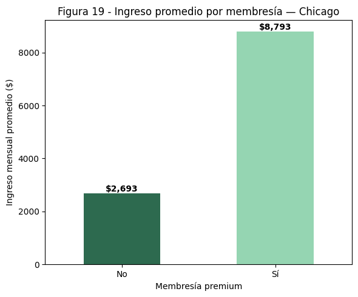
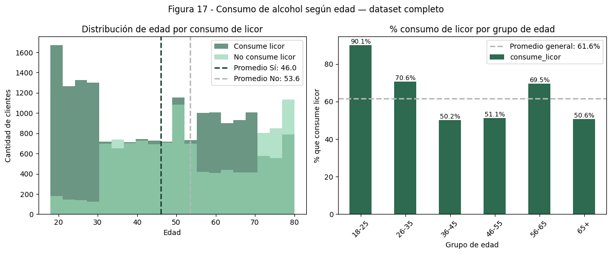
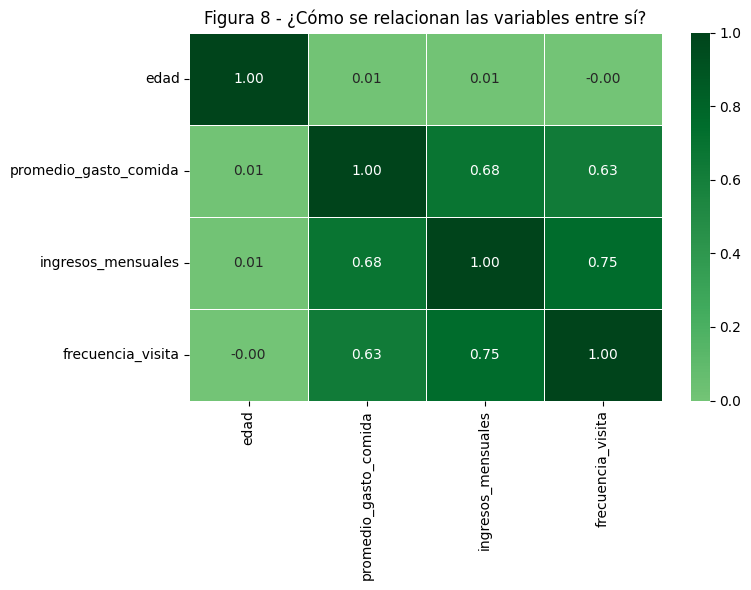
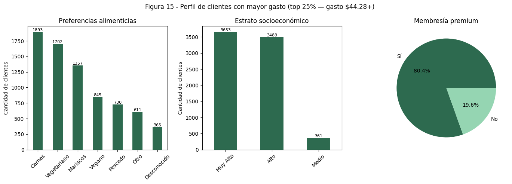

# Informe ejecutivo — Hallazgos del análisis de clientes

InsightReach · Análisis de clientes de restaurantes en EE.UU. · Mauricio Melgarejo

Este informe resume, en lenguaje de negocio, los hallazgos del análisis exploratorio de 30.000 clientes de restaurantes y qué decisiones comerciales habilitan. El detalle técnico está en [`1_EDA_exploratorio.ipynb`](1_EDA_exploratorio.ipynb) y [`2_integracion_api_yelp.ipynb`](2_integracion_api_yelp.ipynb).

---

## 1. Resumen ejecutivo

El análisis identifica un cliente premium claramente más valioso, un desequilibrio fuerte entre oferta y demanda por tipo de cocina, y un patrón de consumo en clientes jóvenes que no se está capitalizando comercialmente.

- **El ingreso del cliente es la señal más fuerte de valor comercial** — correlaciona 0,75 con la frecuencia de visita y 0,68 con el gasto promedio. Es la variable más útil para priorizar a qué clientes dirigir esfuerzo comercial.
- **La membresía premium triplica el gasto e ingresos del cliente** frente a quienes no la tienen — y el 25% de clientes de mayor gasto concentra el 80,4% de las membresías premium. El programa premium está funcionando, pero está concentrado en un segmento chico.
- **Hay un desequilibrio claro entre oferta y demanda por tipo de cocina**: en el mercado analizado hay 53 clientes por cada restaurante vegetariano y 70 por cada restaurante de mariscos, contra solo 19 clientes por cada restaurante de carnes. Esos dos nichos están desatendidos en relación a su demanda.
- **Los clientes de 18 a 25 años consumen alcohol muy por encima del resto** (90,1% vs. 61,6% del promedio general), un patrón de consumo fuerte que no está reflejado en ninguna oferta o promoción segmentada por edad en el mercado actual.

**Impacto esperado:** estos cuatro hallazgos apuntan a tres palancas de negocio distintas — expansión del programa premium, entrada a nichos de cocina desatendidos, y marketing segmentado por edad — que no compiten entre sí y pueden trabajarse en paralelo.

---

## 2. Recomendaciones de negocio

1. **Expandir el criterio de elegibilidad premium.** Si el gasto y la frecuencia ya identifican quién sería premium, ampliar el programa a un segmento más amplio de clientes de alto potencial (no solo a quienes ya califican) podría capturar valor hoy no aprovechado.
2. **Evaluar apertura o reconversión de locales a cocina vegetariana o de mariscos** en zonas de alta demanda y baja oferta, antes que seguir compitiendo en el segmento de carnes, donde la oferta ya está saturada en relación a la demanda.
3. **Diseñar una propuesta comercial dirigida a 18-25 años** centrada en la ocasión de consumo de alcohol (ej. happy hour, combos, eventos), dado que es el comportamiento más diferenciado de ese grupo frente al resto de la base.

---

## 3. Limitaciones y supuestos

- El dato de oferta-demanda por tipo de cocina (53, 70 y 19 clientes por local) viene de cruzar los 30.000 clientes con 200 restaurantes obtenidos vía la API de Yelp, filtrados a locales con 50+ reseñas para asegurar una muestra confiable — no es el universo completo de restaurantes del mercado, sino una muestra representativa.
- La correlación entre ingreso y frecuencia/gasto (0,75 y 0,68) es una asociación estadística, no una relación causal: el ingreso explica buena parte de la variación, pero no la totalidad.
- El análisis es un corte transversal (una muestra en un momento dado), no una serie temporal — no muestra si estos patrones están creciendo, estables o cambiando.

---

## 4. Evidencia

Fuente: elaboración propia sobre el dataset de 30.000 clientes — comparación de ingresos entre clientes premium y no premium.

Fuente: elaboración propia sobre el dataset de 30.000 clientes — consumo de alcohol por rango de edad.

Fuente: elaboración propia sobre el dataset de 30.000 clientes — matriz de correlación entre variables numéricas.

Fuente: elaboración propia sobre el dataset de 30.000 clientes — perfil del 25% de clientes de mayor gasto.

---

## 5. Metodología y fuentes

Análisis exploratorio sobre 30.000 clientes de restaurantes en ciudades de EE.UU. (17 columnas: edad, ingresos, membresía, preferencias, frecuencia, gasto), con foco en Chicago (5.071 clientes). Se integró la API de Yelp para obtener 200 restaurantes con 50+ reseñas, usando un rating bayesiano para corregir el sesgo de locales con pocas calificaciones. Detalle completo de limpieza, segmentación y cálculos en los notebooks de este repositorio.
